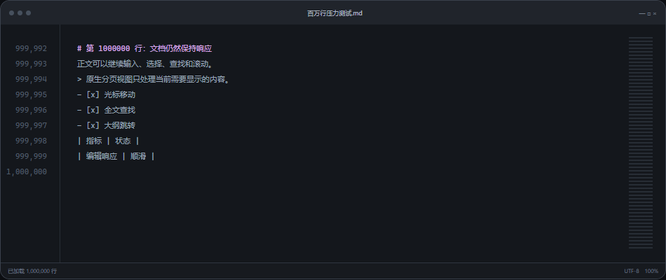
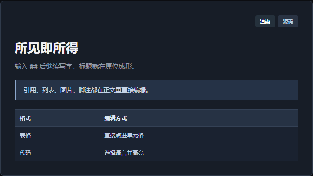
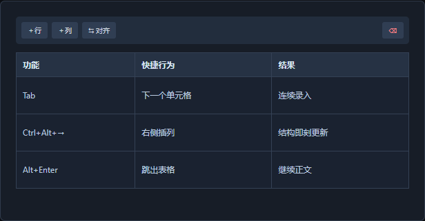
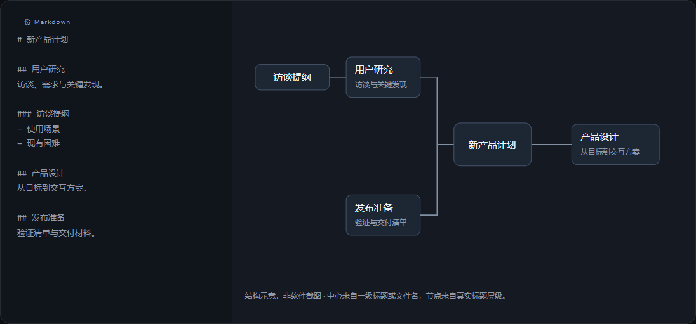
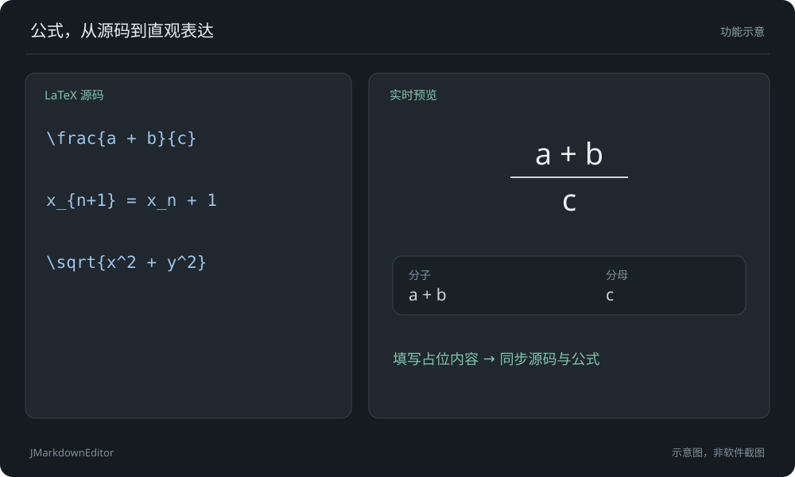
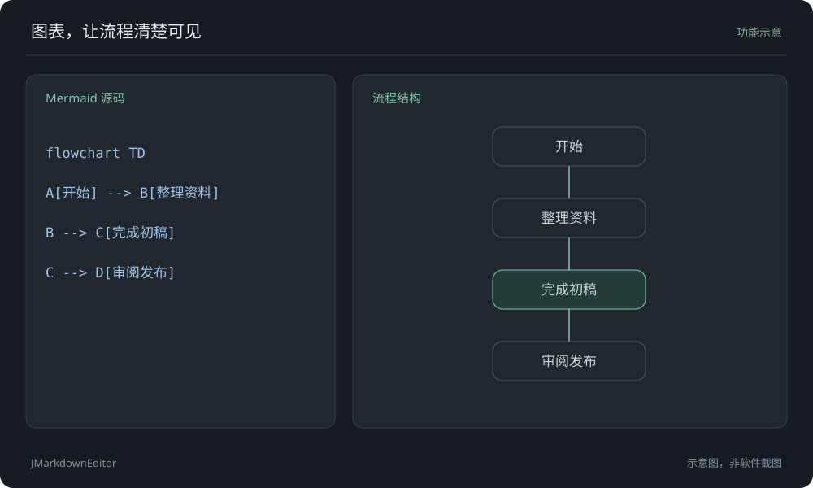
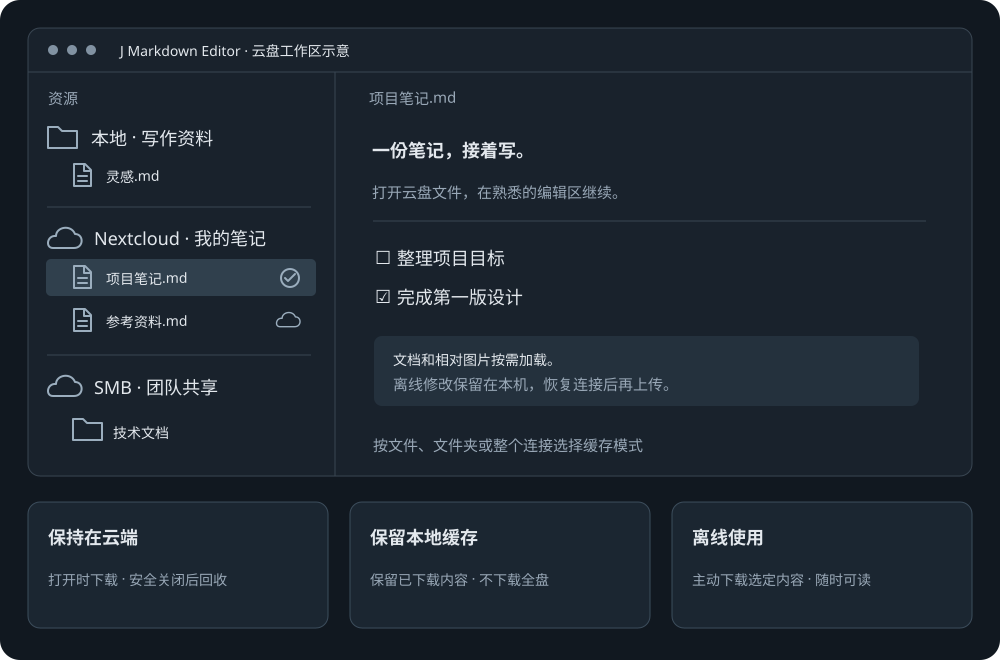

  

<h1 align="center">所见即所得， 高性能原生 Markdown 编辑器</h1>

<strong>JMarkdownEditor</strong> · 原生性能，专注写作

正文、源码、脑图自由切换。 从随手记录，到长篇创作。

  <a href="https://github.com/starrynt/j-markdown-editor/releases/download/v0.57.13/JMarkdownEditor-Setup-windows-x64-native-v0.57.13.exe"><strong>↓ 下载 Windows 版</strong></a>　·　
  <a href="https://github.com/starrynt/j-markdown-editor/releases/download/android-v0.31.0/JMarkdownEditor-android-arm64-v8a-v0.31.0.apk"><strong>↓ 下载 Android 版</strong></a>　·　
  <a href="#下载">所有下载</a>

  <a href="#编辑体验">编辑体验</a>　·　<a href="#文档脑图">文档脑图</a>　·　<a href="#公式与图表">公式与图表</a>　·　<a href="#安卓版">安卓版</a>　·　<a href="#常见问题">常见问题</a>　·　<a href="https://github.com/starrynt/j-markdown-editor/issues">反馈 ↗</a>

<picture>
  <source media="(prefers-reduced-motion: reduce)" srcset="assets/jmarkdown-intro-poster.png">
  
</picture>

编辑与排版功能示意，非软件录屏。

<strong>Windows · Android</strong>　／　本地文件，标准 Markdown　／　无需账号，打开就写

---

## 原生性能

01 / NATIVE CORE · 桌面版

### 原生性能，长文档也流畅。

| C++ / Qt | 100 万+ | ≈ 38 MB |
| :--- | :--- | :--- |
| **原生桌面性能** | **超长文档照常编辑** | **便携版依然小巧** |
| 编辑与渲染直接运行在本机。 | 按需加载，输入、滚动与查找保持响应。 | 体积小巧，公式与图表离线可用。 |

官网长文档界面示意，非软件截图；具体表现随文档和设备而异。

## 编辑体验

02 / EDIT WHAT YOU SEE

### 直接编辑，自然成稿。

**正文与源码，随时切换**

输入 `##` 后继续写字，标题就在原位成形。引用、列表、图片、脚注都在正文里直接编辑；切换模式保留光标，继续编辑不迷路。

**资料、草稿和结果并排打开 · 桌面版**

像代码编辑器一样分栏，分栏对照文档，光标与滚动同步。

**表格直接编辑**

点击录入，快捷增删行列、调整对齐。

以上配图复用官网界面示意，不是软件截图；表格快捷键示例适用于桌面版。

## 文档脑图

03 / DOCUMENT MIND MAP · 桌面版

### 用脑图，整理文章结构。

标题自动生成脑图，拖动节点即可整理章节。正文与脑图共用一份 Markdown。

**卡片 / 最小模式**　·　**章节拖拽**　·　**键盘构思**　·　**大纲同步**

结构示意，非软件截图。中心来自一级标题或文件名，节点来自真实标题层级。文档脑图用于整理章节；Mermaid 思维导图属于正文图表。

## 公式与图表

04 / FORMULAS & DIAGRAMS

### 公式与图表，边写边看。

**LaTeX 独立编辑器 · 桌面版**

编辑公式结构，源码与预览实时同步。支持搜索与收藏、最近使用及 Tab 占位导航。

**Mermaid 独立编辑器 · 桌面版**

模板起步，支持节点改名、连线与键盘操作；提供源码高亮与补全、实时预览及 Ctrl + 滚轮缩放。

**Mermaid 思维导图**

从中心展开分支，用键盘新增和改名。桌面图表编辑支持 Tab 新增子项、Enter 新增同级项、F2 改名。

功能示意，非软件截图。可视化操作因图种而异，复杂内容可编辑源码；安卓支持公式与 Mermaid 原位源码编辑。

## AI 写作

05 / WRITE WITH AI · 桌面版

### 在文档旁讨论，在光标处试改。

**先看结果，再决定保留。** 选中文字，按 <kbd>Ctrl</kbd> + <kbd>J</kbd> 试改。保留、还原或继续追问，由你决定。

- 对话随文档保存，侧栏与悬浮窗口切换。
- 自由配置模型，支持图片消息。
- 读取文档与执行操作需经批准。
- 可连接搜索服务，获取参考来源。

对话内容为演示样例。AI 需自行配置模型，费用与能力由服务商决定。

## 本地与云盘

YOUR FILES / YOUR CLOUD

### 本地与云端，一处管理。

**连接你已有的存储。** 连接 Nextcloud、WebDAV 或 SMB，与本地文件统一管理。

- 桌面本地与云端互传，支持拖拽和批量操作。
- 文档与相对图片按需加载。
- 桌面缓存、离线与云端模式分别设置。
- 同步异常保留本机修改，文件状态清晰可见。

云盘工作区功能示意，非软件截图。需自有账号或共享权限；离线使用会下载所选内容。安卓的云盘、离线与冲突处理见下方介绍。

## 从资料到成稿

06 / YOUR WORKFLOW · 桌面版

### 从整理资料，到交付成稿。

| 一篇文档，多种交付 | 让文档适合你的阅读习惯 |
| :--- | :--- |
| 导出 PDF、Word 与单文件 HTML。 | 调整字体、颜色与留白，保存自己的风格。 |
| **把文件一起整理** | **细节仍由你控制** |
| 多文件夹、批量操作与快速筛选，整理更高效。 | 查找替换、行号与章节折叠，细节随你掌控。 |

文档风格编辑器示意 · 调整样式，实时预览。

## 安卓版

### 手机上，也能继续写。

所见即所得、公式与 Mermaid，还有 Nextcloud / WebDAV 和 SMB 共享文件夹。

- **把注意力留给内容**：标题、强调、任务列表、引用、表格、图片、脚注和提示块直接渲染；公式与 Mermaid 在原位修改源码。紧凑工具栏在阅读滚动时收起，点击或上滑时再出现。
- **一份标准 Markdown，随处接着写**：保存为 UTF-8 `.md` 文件，切换渲染与源码。近期、文件夹、云盘切换时保留浏览位置，按资源能力提供文件操作。
- **连接已有存储**：支持 HTTPS WebDAV、Nextcloud 浏览器登录及局域网 SMB 共享；云文档按需缓存，离线也能打开，本地文件退出编辑时自动保存。
- **冲突不丢内容**：两端修改时进行三方合并，互不重叠的修改自动合并，冲突保留两版标记，并可选择自动合并、保留本机或使用云端。

图片复用官网安卓版界面示例，具体界面以安装版本为准；文档脑图、独立公式／图表编辑器与 AI 写作属于桌面功能。

## 下载

### 想法落笔，让内容自由生长。

选择适合你的平台，继续写下去。以下安装包均直接从 **GitHub Releases** 下载。

| 平台 | 版本 | 安装包 |
| :--- | :--- | :--- |
| Windows x64 · 安装版 | 0.57.13 | [下载 EXE ↓](https://github.com/starrynt/j-markdown-editor/releases/download/v0.57.13/JMarkdownEditor-Setup-windows-x64-native-v0.57.13.exe) |
| Windows x64 · 便携版 | 0.57.13 | [下载 ZIP ↓](https://github.com/starrynt/j-markdown-editor/releases/download/v0.57.13/JMarkdownEditor-windows-x64-native-v0.57.13.zip) |
| Android 8.0+ · arm64-v8a | 0.31.0 | [下载 APK ↓](https://github.com/starrynt/j-markdown-editor/releases/download/android-v0.31.0/JMarkdownEditor-android-arm64-v8a-v0.31.0.apk) |

[Windows SHA-256 校验清单](https://github.com/starrynt/j-markdown-editor/releases/download/v0.57.13/SHA256SUMS.txt)　·　[Android SHA-256 校验清单](https://github.com/starrynt/j-markdown-editor/releases/download/android-v0.31.0/SHA256SUMS.txt)　·　[全部版本与更新说明](https://github.com/starrynt/j-markdown-editor/releases)

Windows 便携版解压即可使用；安卓在手机浏览器下载后打开 APK，按系统提示允许该浏览器安装应用。

## 常见问题

文档脑图与 Mermaid 思维导图有什么区别？

文档脑图直接使用文章的标题层级，修改节点就是修改原 Markdown 章节；Mermaid 思维导图是文档中的图表代码块，两者可同时使用。文档脑图已包含在当前桌面版中。

文档保存在哪里？

保存在你选择的本地目录，格式为标准 UTF-8 Markdown。粘贴的图片进入文档旁的资源目录。

需要联网吗？

本地编辑、公式和图表渲染无需联网。云盘同步、远程图片、更新检查及远程 AI 服务需要网络；本地模型的联网要求由其部署方式决定。

AI 是免费内置的吗？会自动上传文档吗？

软件不附带模型额度，需自行配置兼容的模型服务，费用由服务商决定。只有主动使用 AI 时才向所选服务发送消息；读取文档或发送选区默认需要批准。选择完全访问权限后，关联文档的技能操作不再逐项询问。详见 <a href="https://markdown.wenlj.cn/privacy.html">隐私说明</a>。

公式和图表可以全部用鼠标编辑吗？

常用公式结构、矩阵和部分 Mermaid 图种支持直接编辑；不同图种的可视化能力不同。复杂语法可在独立窗口左侧编辑源码，右侧实时预览。

导出会保留全部效果吗？

支持 PDF、Word 和 HTML，表格、图片及已支持的公式和图表可随文档导出。Word 使用文档样式重建布局，不保证与屏幕逐像素一致；不同阅读软件的显示也可能有差别。

支持哪些系统？

提供 Windows x64 安装版、便携版，以及 Android 8.0+ 安卓版。<a href="#安卓版">查看安卓版介绍与下载</a>。

下载时提示“不常下载”怎么办？

      
这是 Edge SmartScreen 的下载信誉提示，不等于已检测出病毒。当前官网安装包和便携包中的程序尚未配置受信任的代码签名，新版本也可能缺少足够的下载信誉。

      <ol><li>确认从本仓库的 GitHub Releases 下载，并核对下方 <a href="https://github.com/starrynt/j-markdown-editor/releases/download/v0.57.13/SHA256SUMS.txt">SHA-256 校验清单</a>；校验值一致仅说明文件与发布包一致。</li><li>确认来源并决定继续时，可在 Edge 下载列表中打开该项的“…”菜单，选择“保留”；若还有确认页面，再选择“显示更多 → 仍然保留”（名称可能因版本不同）。</li><li>若提示明确检测到病毒或恶意软件，不要按普通信誉提示处理，请记录检测名称并反馈。</li></ol>
      
保留下载不会解除 Windows 的安装拦截。了解 <a href="https://learn.microsoft.com/en-us/deployedge/microsoft-edge-security-smartscreen">微软 SmartScreen 下载检查</a>。

    

安装或更新提示“此应用的一部分已被阻止”怎么办？

      
若同时显示“无法确认是谁发布了这些功能”，可能是 Windows 11 智能应用控制拦截了未受信任的安装包或组件。软件内的“无法启动更新安装程序”也可能由此引起，不能只凭这一条软件提示确定原因。

      <ol><li>打开“Windows 安全中心 → 应用和浏览器控制 → 智能应用控制设置”，查看是否开启。</li><li>需要确认被拦截文件时，按 Win+R 输入 <code>eventvwr.msc</code>，进入“应用程序和服务日志 → Microsoft → Windows → CodeIntegrity → Operational”，查看失败时间附近的记录，将文件路径和原因反馈给我们。这类记录可能不在病毒防护历史中。</li><li>若确认是智能应用控制拦截，且你信任下载来源，可自行决定是否关闭该功能后重试。关闭会减少对不受信任应用的保护，影响所有应用；它不会同时关闭 Defender 杀毒及实时保护。不需要关闭其它安全功能。</li></ol>
      
受信任的代码签名是发布端的长期改进方向；更换下载地址或清理缓存不能解决签名策略拦截。详见 <a href="https://support.microsoft.com/en-gb/windows/security/threat-malware-protection/smart-app-control-frequently-asked-questions">微软智能应用控制问答</a>。

    

能添加白名单，或安装后重新开启智能应用控制吗？

      
智能应用控制目前不支持单独放行某个应用。Defender 的病毒扫描排除项不能代替它的白名单；先安装成功，也不会让程序或后续更新永久受信任。

      
近期 Windows 更新允许符合条件的设备在上述设置中重新开启，无需重装。请先安装系统更新，再查看“开启”是否可用；旧版本或不满足条件的设备可能仍受限制。重新开启后，未受信任的程序、组件或新安装包仍可能被拦截。

      
以设备上的实际设置和 <a href="https://support.microsoft.com/en-gb/windows/security/threat-malware-protection/smart-app-control-frequently-asked-questions">微软最新说明</a>为准。

    

---

<strong>JMarkdownEditor</strong> · 本地文件，标准 Markdown

<a href="https://markdown.wenlj.cn/">产品官网</a>　·　<a href="https://markdown.wenlj.cn/privacy.html">隐私说明</a>　·　<a href="https://github.com/starrynt/j-markdown-editor/issues">反馈问题 ↗</a>　·　<a href="https://wenlj.cn/">JayWorks ↗</a>

本仓库提供产品介绍、发布包和问题反馈，暂不包含应用源码。

<!-- jmarkdown-readme:{"downloads":{"android":{"files":[{"name":"JMarkdownEditor-android-arm64-v8a-v0.31.0.apk","sha256":"26bba99ce0f34f3c5ad9430da44413c9bc4cd5cf50260673b584ac09dfe14730","url":"https://github.com/starrynt/j-markdown-editor/releases/download/android-v0.31.0/JMarkdownEditor-android-arm64-v8a-v0.31.0.apk"}],"version":"0.31.0"},"windows":{"files":[{"name":"JMarkdownEditor-Setup-windows-x64-native-v0.57.13.exe","sha256":"14994d919f7ca97e50023814d8f12a3021d368d0c7b6f13cf17f93aa7acfa725","url":"https://github.com/starrynt/j-markdown-editor/releases/download/v0.57.13/JMarkdownEditor-Setup-windows-x64-native-v0.57.13.exe"},{"name":"JMarkdownEditor-windows-x64-native-v0.57.13.zip","sha256":"548e81c82845a35eec70aa0d9e42bcd7738d7fe7d167b30003267c7134d13ec9","url":"https://github.com/starrynt/j-markdown-editor/releases/download/v0.57.13/JMarkdownEditor-windows-x64-native-v0.57.13.zip"}],"version":"0.57.13"}},"schema":1} -->
